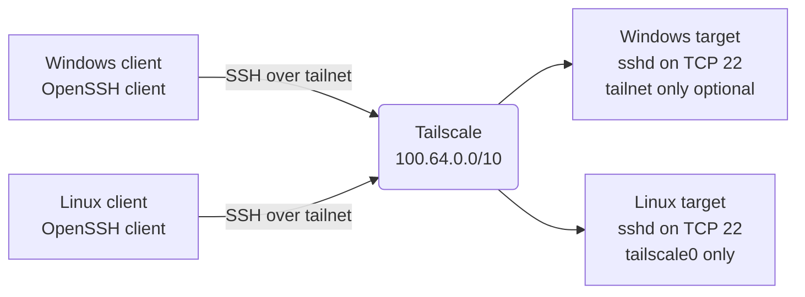

# ssh-bootstrap: Remote SSH Access for Windows and Linux

Two idempotent setup scripts that make a Windows machine and a CachyOS/Arch machine reachable over SSH from anywhere, using a Tailscale tailnet instead of router port forwarding.

- Repository: `https://github.com/kmanisk/ssh-bootstrap` (public)
- Branch: `main`
- Raw base: `https://raw.githubusercontent.com/kmanisk/ssh-bootstrap/main/`
- Platform: Windows 10 1809+ / 11 and CachyOS (Arch-based)
- Transport: Tailscale (WireGuard) + OpenSSH Server
- Host on this machine: `onyx`, user `manisk`

---

## Architecture



Key properties:

- No public port exposure and no port forwarding. The SSH port is reachable only by devices in the same tailnet.
- Both machines authenticate to the same Tailscale account.
- Windows uses the native OpenSSH Server capability. Linux uses the distribution `openssh` package.
- Tailscale SSH is optional on Linux (`--tailscale-ssh`). The default is plain OpenSSH with keys or passwords.

## Repository Layout

| File | Purpose |
|---|---|
| `windows-remote-setup.ps1` | Windows setup: OpenSSH Server, default shell, `sshd_config`, optional key, firewall, Tailscale, power settings |
| `linux-remote-setup.sh` | Linux setup: `tailscale` + `openssh` install, service enablement, firewall rule, login check, summary |
| `README.md` | Usage instructions and parameter reference |

## Prerequisites

| Requirement | Notes |
|---|---|
| Tailscale account | Same account on both machines; free plan is sufficient |
| Windows | Windows 10 1809 or newer; internet access for the optional feature and Tailscale |
| Linux | CachyOS or another Arch-based distribution with `pacman` and `systemd` |
| Linux user | A login user with a password, or a pre-installed public key |
| Firewall | `ufw` or `firewalld` on Linux; Windows Defender Firewall is configured by the script |

---

## Windows Setup

Run from PowerShell. No git, no clone, no saved file required.

```powershell
& ([scriptblock]::Create((iwr -UseBasicParsing https://raw.githubusercontent.com/kmanisk/ssh-bootstrap/main/windows-remote-setup.ps1).Content))
```

With a public key. A valid key disables password authentication automatically:

```powershell
& ([scriptblock]::Create((iwr -UseBasicParsing https://raw.githubusercontent.com/kmanisk/ssh-bootstrap/main/windows-remote-setup.ps1).Content)) -PublicKey 'ssh-ed25519 AAAAC3Nza... manisk@onyx'
```

File-based variant, equivalent behaviour:

```powershell
iwr -UseBasicParsing https://raw.githubusercontent.com/kmanisk/ssh-bootstrap/main/windows-remote-setup.ps1 -OutFile $env:TEMP\win-setup.ps1; & $env:TEMP\win-setup.ps1
```

### Elevation Behaviour

| Starting point | Result |
|---|---|
| Elevated prompt (`Administrator: Windows PowerShell`) | Runs directly in the same window, no relaunch |
| Normal prompt | Relaunches itself through UAC |
| Loaded from memory with `iwr` (no local path) | The elevated instance downloads the same URL again and runs there |

### What the Script Changes

1. Installs OpenSSH Server through winget (`Microsoft.OpenSSH.Preview`), a single MSI that completes in seconds. Falls back to the `OpenSSH.Server` optional feature (Windows Update, 5-15 minutes) when winget is missing or the install fails. An existing `sshd.exe` in either location is reused.
2. Creates `C:\ProgramData\ssh\sshd_config` from the package template when it is missing, with ACLs restricted to `SYSTEM` and `Administrators`.
3. Sets `sshd` to automatic start and starts it; `ssh-agent` is enabled as well.
4. Sets `HKLM:\SOFTWARE\OpenSSH\DefaultShell`; adds `C:\Program Files\OpenSSH` to the machine `PATH` for non-inbox installs.
5. Backs up `C:\ProgramData\ssh\sshd_config` to `sshd_config.bak` on first run, then sets:
   - `Port`
   - `PasswordAuthentication`
   - `PubkeyAuthentication yes`
   - `MaxAuthTries 3`
   - `LoginGraceTime 30`
6. Missing directives are inserted at the top of the file so they stay outside the `Match Group administrators` block. Existing directives are replaced in place.
7. Installs the public key in `C:\ProgramData\ssh\administrators_authorized_keys` and restricts ACLs to `Administrators` and `SYSTEM`.
8. Creates or updates the firewall rule `OpenSSH-Server-In-TCP` for the configured port and disables the preview MSI rule, so a single managed rule applies.
9. Installs Tailscale through `winget` and falls back to the official MSI.
10. Disables sleep and hibernate timeouts on AC power and sets the lid-close action to "do nothing".
11. Validates the configuration with `sshd -t`, restarts `sshd`, and prints the summary, including the Tailscale IP when available.

Log file: `C:\ProgramData\remote-access-setup.log`.

### Parameters

| Parameter | Description |
|---|---|
| `-PublicKey "<key line>"` | Installs the key for the administrators group. Disables password auth unless `-AllowPasswordWithKey` is also passed |
| `-AllowPasswordWithKey` | Keeps password authentication enabled even when a key is supplied |
| `-DisablePasswordAuth` | Public keys only |
| `-Port <n>` | SSH port, default 22. The firewall rule is updated to match |
| `-RestrictToTailnet` | Restricts inbound SSH to `100.64.0.0/10`. Blocks LAN access too; enable only after Tailscale is signed in |
| `-SkipTailscale` | Does not install or modify Tailscale |
| `-SkipPowerTweaks` | Does not change sleep and lid-close settings |

---

## Linux Setup

```bash
curl -fsSL https://raw.githubusercontent.com/kmanisk/ssh-bootstrap/main/linux-remote-setup.sh | sudo bash
```

With flags:

```bash
curl -fsSL https://raw.githubusercontent.com/kmanisk/ssh-bootstrap/main/linux-remote-setup.sh | sudo bash -s -- --allow-lan
```

File-based variant. The script re-executes itself with `sudo` when a path is available:

```bash
curl -fsSL https://raw.githubusercontent.com/kmanisk/ssh-bootstrap/main/linux-remote-setup.sh -o /tmp/linux-setup.sh && bash /tmp/linux-setup.sh
```

In piped mode the script has no path to re-execute, so it must already run as root. That is why the one-liner uses `sudo bash`.

### Flags

| Flag | Description |
|---|---|
| `--allow-lan` | Also allows TCP/22 on all interfaces, not just `tailscale0` |
| `--tailscale-ssh` | Also enables Tailscale SSH (keyless, identity based) in addition to `sshd` |
| `-h`, `--help` | Prints usage |

### What the Script Changes

1. Verifies `pacman` is present (Arch-based distributions only).
2. Installs `tailscale` and `openssh` with `pacman -S --needed --noconfirm`.
3. Enables and starts `tailscaled` and `sshd`.
4. Firewall:
   - `ufw` active: allows TCP/22 inbound on `tailscale0` only.
   - `firewalld` active: adds `tailscale0` to the trusted zone.
   - Neither active: prints a warning instead of guessing.
5. Checks the Tailscale backend state. When not signed in, runs `tailscale up` and prints the login URL.
6. Prints hostname, user, Tailscale IP, service state, and the exact `ssh` command to use from the other machine.

---

## Tailscale Login

The only interactive step. Both machines must use the same Tailscale account.

```powershell
# Windows
& "C:\Program Files\Tailscale\tailscale.exe" up
```

```bash
# Linux
sudo tailscale up
```

Verify from either side:

```bash
tailscale status
tailscale ping onyx
```

---

## Connection Flow: Windows to Linux

### Step 1: Linux side

```bash
systemctl is-active sshd        # active
sudo tailscale ip -4            # 100.x.y.z
sudo ss -tlnp | grep ':22'      # sshd listening
hostname                        # onyx
```

### Step 2: Windows side

```powershell
& "C:\Program Files\Tailscale\tailscale.exe" status
Test-NetConnection 100.x.y.z -Port 22
```

### Step 3: Connect

```powershell
ssh manisk@100.x.y.z
```

With MagicDNS enabled the hostname works as well:

```powershell
ssh manisk@onyx
```

First connection prompts to accept the host key fingerprint. Authentication uses the Linux user password unless a key is installed.

### Step 4: Key authentication

One-time setup. After this, no password prompt.

```powershell
ssh-keygen -t ed25519 -C "windows@pc"
type $env:USERPROFILE\.ssh\id_ed25519.pub | ssh manisk@onyx "mkdir -p ~/.ssh && cat >> ~/.ssh/authorized_keys && chmod 700 ~/.ssh && chmod 600 ~/.ssh/authorized_keys"
ssh manisk@onyx
```

### Step 5: File transfer

```powershell
# Windows to Linux
scp C:\Users\me\file.txt manisk@onyx:~/

# Linux to Windows
scp manisk@onyx:~/file.txt .
```

---

## Reverse Direction: Linux to Windows

```bash
ssh <windows-user>@<windows-tailscale-ip>
```

Notes:

- The Windows account needs a real password. A PIN or Windows Hello only credential does not work for SSH.
- Prefer key authentication: run the Windows script once with `-PublicKey` containing the Linux machine's `~/.ssh/id_ed25519.pub`.
- Administrator accounts read keys from `administrators_authorized_keys`, which the script handles.

---

## Troubleshooting

| Symptom | Checks |
|---|---|
| `Connection timed out` | `tailscale status` on both sides; both devices online and same account |
| `Connection refused` | Linux: `systemctl status sshd`, `sudo ss -tlnp \| grep ':22'`. Windows: `Get-Service sshd` |
| `Permission denied (publickey,password)` | Wrong user or password; key missing from `authorized_keys` or `administrators_authorized_keys` |
| Devices visible but no connectivity | `tailscale ping onyx` from both sides; check ACLs in the Tailscale admin console |
| Works on LAN, not over tailnet | `sudo ufw status` must show `22/tcp on tailscale0 ALLOW` |
| Windows rejects the key | ACL on `administrators_authorized_keys` must be `Administrators` and `SYSTEM` only |
| Download fails on old PowerShell 5.1 | Prefix with `[Net.ServicePointManager]::SecurityProtocol='Tls12';` |
| Tailscale installed but no IP | Login was never completed: run `tailscale up` |

---

## Security Notes

- Tailscale traffic is end-to-end encrypted. Only tailnet devices can reach the SSH port.
- Prefer public keys. Password authentication on an internet-reachable port is a brute-force target.
- `-RestrictToTailnet` and the default Linux firewall rule limit SSH to the Tailscale interface. Enable the Windows flag only after Tailscale is signed in, otherwise LAN access is also blocked.
- Do not use `tailscale funnel` for SSH. It publishes the service to the public internet.
- The scripts contain no secrets. Keys are passed at runtime and never stored in the repository.

---

## Maintenance

- `$ScriptSourceUrl` inside `windows-remote-setup.ps1` is the only hardcoded repository reference. Update it if the repository or branch is renamed.
- Hostname and username are never hardcoded. Windows reads `$env:COMPUTERNAME` and `$env:USERNAME`; Linux reads `hostname` and `logname`/`SUDO_USER`. Renaming a machine or user requires no script change.
- Both scripts are idempotent. Re-running them is safe and does not duplicate configuration.
- The Windows script inserts missing `sshd_config` directives at the top of the file, so they remain outside the `Match Group administrators` block.

## Verification Performed

| Check | Result |
|---|---|
| PowerShell parser (7.6.7) | No errors |
| `bash -n` | No errors |
| `shellcheck -S warning` | Clean |
| iex elevation path | Generated `-Command` parses; scriptblock parameters passed correctly |
| File elevation path | Generated `-File` arguments correct |
| Already elevated | No relaunch |
| Piped Linux mode as non-root | Clear error, exit code 1 |
| Raw URLs | HTTP 200 for all three files |
| Local and remote copies | Identical SHA-256 |
