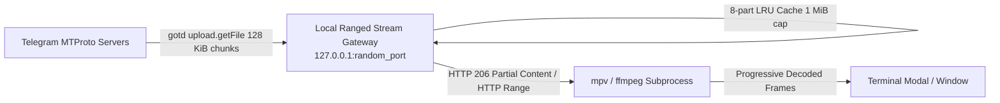

# Tele: Progressive Video Streaming Architecture (PR #321)

Specification and architectural reference for upstream pull request [sorokin-vladimir/tele#321](https://github.com/sorokin-vladimir/tele/pull/321): `feat: play videos without waiting for the full download`.

- **Author:** Kumar Manisk (`@kmanisk`)
- **Upstream PR:** [sorokin-vladimir/tele#321](https://github.com/sorokin-vladimir/tele/pull/321)
- **Local Branch:** `feat/video-streaming` in [`/home/onyx/Projects/tele-video-streaming`](file:///home/onyx/Projects/tele-video-streaming)
- **Upstream Base:** `main` at `6aa6cf9`

---

## 1. Problem Statement & Baseline Analysis

In upstream Tele (`6aa6cf9`):
1. **In-App Video Playback:** `root_media.go` used Kitty graphics + ffmpeg for the in-app video modal, requiring `Surface.SaveMedia(DocFull)` via `mediaFetcher.Save`. This forced a sequential download of the entire video file to a temporary disk path before `videoFileReadyMsg` and `OpenFrameSource` could initialize ffmpeg.
2. **External Playback:** `openDocumentCmd` similarly blocked on full-file completion before launching `xdg-open` or `mpv`.
3. **User Impact:** Playing long or high-bitrate videos introduced multi-minute latency, blocking media consumption until 100% of bytes were received.

---

## 2. Architecture: Private Ranged Loopback Streaming

Rather than downloading full media files to disk, PR #321 introduces a lightweight, zero-disk, range-aware loopback HTTP streaming gateway.



### 2.1 Chunk Alignment & Memory Discipline
- **Chunk Sizing:** Fetches aligned 128 KiB blocks via `gotd/contrib` `tg_io.ChunkSource`. This cleanly subdivides Telegram's 1 MiB wire transfer window and satisfies the strict 1 KiB alignment requirement of Telegram's file download API.
- **LRU Cache Bound:** Employs an 8-part LRU cache retaining at most 1 MiB of in-memory chunks per active stream.
- **Concurrency Guard:** Exactly one upstream Telegram network read in flight per stream session, avoiding server throttling and duplicate requests.
- **Zero Disk Writes:** Streamed data is never written to disk, avoiding NVRAM/SSD wear and Btrfs fragmentation.

### 2.2 Loopback Server & Security Bounds
- **Local Binding:** Private HTTP server binds strictly to loopback (`127.0.0.1:0`) on an ephemeral port.
- **Route Entropy:** Streaming URLs utilize 256 bits of cryptographically secure random path segments.
- **HTTP Semantics:** Full compliance with RFC 7233 range requests (single bounded, open-ended, suffix ranges, returning HTTP 206 Partial Content or HTTP 416 Range Not Satisfiable). Multipart byte ranges are cleanly rejected.
- **Proxy Bypass:** Built-in loopback requests configure `no_proxy` rules so system HTTP proxies do not intercept internal media transport.

### 2.3 Session Lifecycle & Monotonic Sequencing
- **Session Ownership:** Handled through `OpenMediaStream(chatID, msgID, seq)` and `CloseMediaStream(seq)`.
- **Sequence Safety:** Monotonically increasing sequence IDs prevent delayed IPC responses or out-of-order closes from terminating newer media sessions.
- **Automatic Teardown:** Streams terminate immediately on modal close, album paging, account detachment, or process exit. A 4-hour inactivity deadline acts as an absolute backstop.

---

## 3. Verification & Test Suite

The progressive streaming architecture is backed by automated race-detected unit and integration tests:

```bash
# Execute progressive stream test suite with race detector
go test -race ./internal/videostream ./internal/core ./internal/tg ./internal/ui ./internal/ipc/...

# Headless mpv integration test
TELE_MPV_TEST=1 go test -race -v ./internal/videostream
```

Tests validate:
- Aligned and unaligned chunk offsets across boundary limits.
- Cache eviction under rapid forward seeking (simulated 2 GiB seeks).
- Stale file reference token refresh and cooldown backoff.
- mpv process termination and socket teardown upon modal close.
